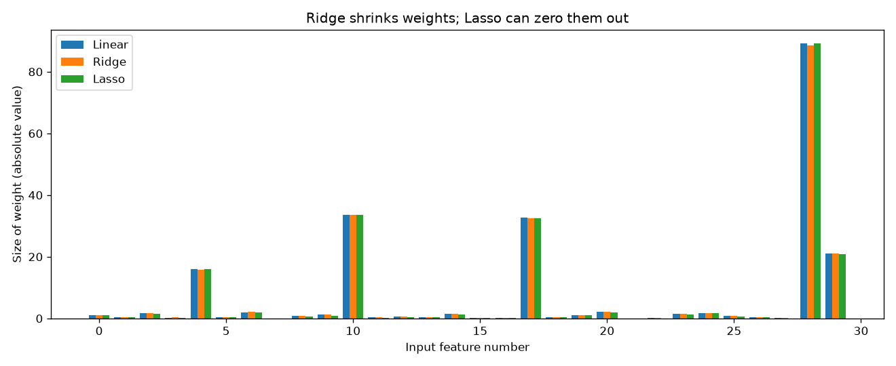
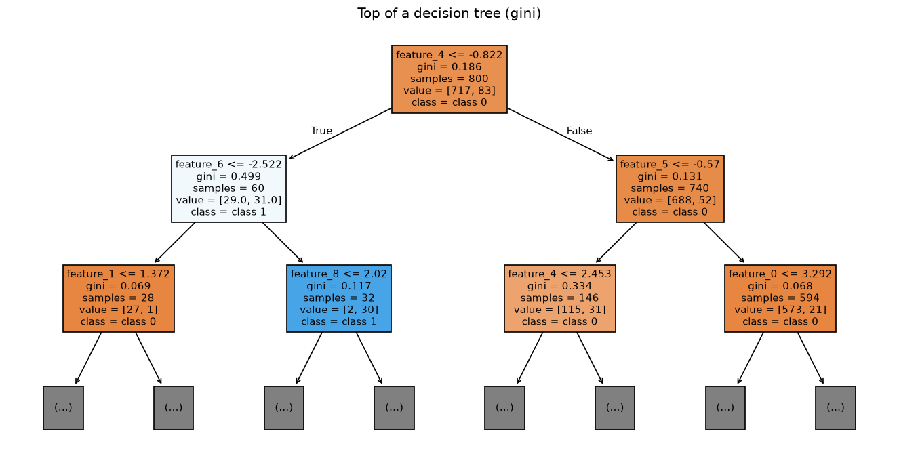
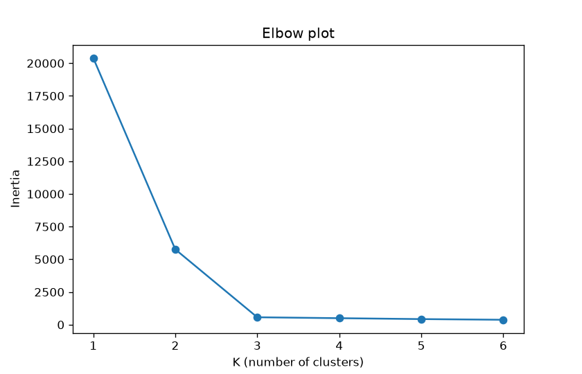
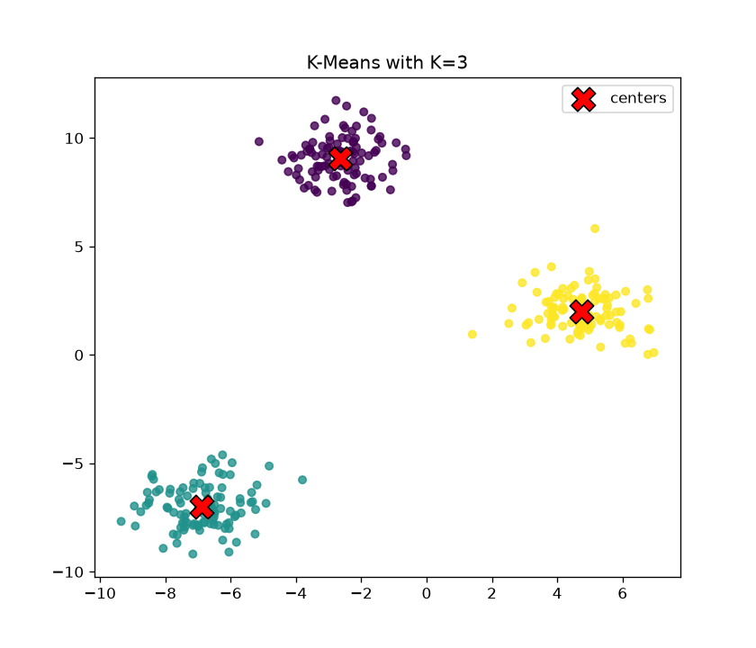

# ml-basics-lab


Small, runnable demos of the core machine learning ideas, built on fake data so every result can be checked.

## Why I built this

I'm learning machine learning on the way to GenAI and Agentic AI. I wanted to see each idea work with my own eyes, not just read about it, so I wrote small scripts and checked the numbers myself.

## Setup

```bash
python -m venv .venv
source .venv/bin/activate        # Windows: .venv\Scripts\activate
pip install -r requirements.txt
python run_all.py
```

Charts are saved to `outputs/`.

## Results

**Ridge vs Lasso (regularization)**

Test R² was 0.983 for plain linear regression, 0.983 for Ridge, and 0.984 for Lasso. Lasso set 2 of the 30 coefficients to exactly zero.



**Accuracy can hide a useless model (evaluation)**

A baseline that always predicts the majority class got 0.895 accuracy but 0.000 recall, so it never caught a single real positive. The logistic regression got 0.915 accuracy and 0.238 recall (5 of 21 positives caught).

**Decision trees and overfitting**

A tree with no depth limit reached 1.000 training accuracy but 0.935 test accuracy, a gap of 0.065. Limited to depth 3, the Gini tree scored 0.920 and the entropy tree 0.940 on test data.



**K-Means and the elbow**

Inertia dropped from 20402.3 (K=1) to 5763.5 (K=2) to 566.9 (K=3), then only slowly: 496.4 at K=4, 427.1 at K=5, 375.0 at K=6. The data was built with 3 blobs, and the sharp bend sits at K=3.





## Files and roadmap days

| File | Roadmap days | Topic |
|---|---|---|
| `data.py` | - | Makes the synthetic datasets |
| `01_regularization.py` | 62-66 | Ridge vs Lasso |
| `02_classification.py` | 69-74 | Logistic regression, sigmoid, binary cross-entropy |
| `03_evaluation.py` | 75-76 | Confusion matrix, precision, recall, F1 |
| `04_decision_tree.py` | 80 | Entropy vs Gini, max_depth, overfitting |
| `05_kmeans.py` | 103 | K-Means clustering and the elbow method |
| `run_all.py` | - | Runs everything and prints a summary |

## What I learned

- Lasso did not remove many features here. With alpha=0.1 it zeroed only 2 of 30 coefficients, so the penalty strength matters a lot, and I had to check the numbers instead of assuming.
- Accuracy alone is misleading with imbalanced data. The majority-class baseline looked fine on accuracy (0.895) but never found a real positive.
- Confident wrong answers cost the most in cross-entropy. Predicting 0.95 for a true 0 gave a loss of 2.996, while a correct 0.9 guess gave 0.105.
- An unlimited decision tree memorized the training data (1.000 training accuracy). Limiting depth gave the more honest test scores.
- The elbow was clear at K=3 because the data was built with 3 groups. On messier real data the bend would be much harder to see, so the elbow is a hint, not a rule.

## Next steps

- Build a text classifier (for example, spam vs not spam) using TF-IDF features and compare it to the same metrics used here.
- Make a small retrieval-augmented generation (RAG) demo that answers questions from my own notes, and measure how often the retrieved text is actually relevant.
